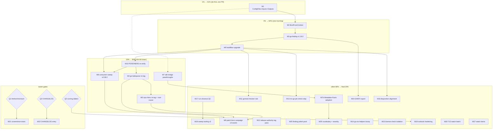

# Library-Utilization Outcomes & Backlog — Pareto Execution Plan

**Written:** 2026-11-23 01:32 CET · **Author:** fleet-run orchestrator session
**Inputs:** TODO_LIST.md (T1–T17, read in full), docs/status/2026-11-23_01-28_library-utilization-fleet-run-shipped-self-review.md (section f, 30 items), docs/review/libs/* (7 reports + index), CHANGELOG (no evidence any backlog item already shipped — daemon commits since 2026-10-17 were docs-only).

**Errata / staleness disclosure (step-0 discipline):** T1/T14/T16 counts were last verified 2026-10-17 (46 days ago): "91 patch-form projects", "3 repos pinning go-output v0.38.2", "BuildFlow built at 7baef1c" may have drifted. Every task below that consumes a stale count carries a **re-verify first** micro-task; no number is trusted blindly. T3 (website) is an owner decision of 2026-10-03 (demand-gated non-commitment) — parked, not planned.

---

## 1. Pareto Breakdown

### The 1% that delivers 51%

**M1 — Declare the provider's true read/write surface to BuildFlow** (`ConfigFiles`/`Spec.Inputs` = go.mod, go.work, flake.nix, .github/workflows/\*, VERSION, CHANGELOG.md + `Spec.Outputs`). One PR, ~3 lines + tests. Until it lands, **BuildFlow does not even run this tool on flake.nix or CI-pin drift — the majority of the tool's core scenarios** (T17-1+2, the run's top finding, independently confirmed by two audit groups). Everything else optimizes a tool that under-triggers today.

### The 4% that delivers 64% (cumulative with the 1%)

| +Task                       | Why it is in this tier                                                                                               |
| --------------------------- | -------------------------------------------------------------------------------------------------------------------- |
| M2 BoolFromContext swap     | Silent-misconfig class fix: wrong-typed option values currently behave as unset (correctness of every future option) |
| M3 go-finding v1.16.0 bump  | Currency at trivial cost; unblocks SARIF/propertyBag work later                                                      |
| M6 BuildFlow binary upgrade | Every BuildFlow judgment (doctor, gates) is suspect while stale; force multiplier for all following work             |

### The 20% that delivers 80% (cumulative)

| +Task                                            | Why                                                                                 |
| ------------------------------------------------ | ----------------------------------------------------------------------------------- |
| M4 go-taskqueue re-tag campaign                  | Kills live poisoner #1 — every consumer stops re-poisoning on tidy                  |
| M5 cqrs-htmx re-tag wave + regression root-cause | Kills live poisoner #2 (regressed v4.14.x); without root-cause it recurs            |
| M7 Upstream bridge passthroughs (sdk)            | Fleet-unblocking: ConfigIssue.Metadata + structured Repair for ALL auto-configurers |
| M8 Consumer sweep v0.38.2 + ADR refresh          | Continues the campaign; measurably shrinks the poisoned fleet                       |
| M10 POISONERS re-verify                          | Keeps the ledger honest before driving campaigns off it                             |

### The other 80% (of effort) → final 20% (of result)

M9 (patch-form campaign, 3 waves), M11 (gomod-checker rule), M12 (release-authority 2nd pass), M13 (flake.lock step), M14–M16 (tooling debt), M17–M20 (run closeout + infrastructure), M23–M27 (post-M7 / worth-considering / watch items). Long tail, real but not compounding.

### Parked (owner-gated, not planned)

- T3 website launch — demand-gated non-commitment (2026-10-03). Trigger: real demand signal.
- M21 screenshot + vision verification — blocked on owner Q1 (firefox permission / headless chromium).
- M22 CHANGELOG entry — blocked on owner Q3 (convention decision).
- Scoring-dialect normalization (runbook) — blocked on owner Q2; folded into M19 as "apply owner's answer".

---

## 2. Comprehensive Plan — medium granularity (30–100 min, sorted by importance/impact/effort/customer-value)

| #   | Task                                                                                                                                | Source   | Tier   | Est    | Impact   | Effort   | Depends      |
| --- | ----------------------------------------------------------------------------------------------------------------------------------- | -------- | ------ | ------ | -------- | -------- | ------------ |
| M1  | Provider declarative completeness: ConfigFiles + Spec.Inputs (6 file classes) + Spec.Outputs + trigger-matrix tests                 | T17-1/2  | 1%     | 45m    | HIGH     | LOW      | —            |
| M2  | Swap raw bool assertion → toolsdk.BoolFromContext (+ wrong-typed test)                                                              | T17-3    | 4%     | 30m    | MED      | LOW      | —            |
| M3  | Bump go-finding v1.15.1→v1.16.0, full tests, no-behavior-delta check                                                                | T17-5a   | 4%     | 30m    | MED      | LOW      | —            |
| M6  | buildflow upgrade + doctor re-baseline inside devShell                                                                              | T16-4    | 4%     | 30m    | MED      | LOW      | —            |
| M4  | go-taskqueue supply-side re-tag (strip, dep-order, re-tag, verify proxy, POISONERS)                                                 | T14-1    | 20%    | 100m   | HIGH     | MED      | M10          |
| M5  | cqrs-htmx re-tag wave + v4.14.0 regression root-cause + importer map                                                                | T14-2/3  | 20%    | 100m   | HIGH     | MED      | M10          |
| M7  | Upstream: linter-autoconfigure-sdk ConfigIssue.Metadata + Repair passthrough, tag, repin here                                       | T17-4    | 20%    | 100m   | HIGH     | MED      | —            |
| M8  | Consumer sweep: bump go-output v0.38.2 pins, fleet check, ADR refresh                                                               | T1-1     | 20%    | 60m    | MED-HIGH | MED      | M6           |
| M10 | Fresh who-forces on POISONERS Active rows (x/text, json/v2, cqrs-htmx, go-taskqueue)                                                | T1-3     | 20%    | 30m    | MED      | LOW      | —            |
| M17 | Run closeout: semantic QC of 10 Group B/C cites + report format normalization + errata                                              | f-8/11   | 80%    | 60m    | LOW-MED  | LOW      | —            |
| M18 | Sweep tooling v2: module-cache resolution, ambiguity report, docs-gate wiring                                                       | f-12..14 | 80%    | 60m    | MED      | MED      | M17          |
| M9  | Patch-form campaign: triage 91→dep-forced vs drifted via who-forces, fix in 3 waves, re-measure, ADR                                | T1-2     | 80%    | 100m×3 | HIGH     | HIGH     | M4, M5       |
| M11 | BuildFlow gomod-checker "tidy revert" rule (reuse CompareDirective; fixtures a/b/c)                                                 | T5       | 80%    | 100m   | MED-HIGH | MED      | M6           |
| M12 | Release-authority 2nd pass: git-tag third source in fix-side caller (go/version)                                                    | T6       | 80%    | 100m   | MED      | MED      | —            |
| M13 | BuildFlow step nix-go-pin-check (impure flake.lock half; fake nix eval tests)                                                       | T9       | 80%    | 100m   | MED      | MED-HIGH | M6           |
| M7b | Adopt Finding.Metadata + RepairResult.Facts/ModifiedFiles in provider once bridge ships                                             | T17-4/5b | 80%    | 45m    | MED      | LOW      | M7           |
| M19 | Fleet-run runbook hardening (SKILLS repo): dialect spec, inventory template, ask-on-failure, spot-check quota, screenshot preflight | f-16..20 | 80%    | 45m    | MED      | LOW      | owner Q2     |
| M20 | T12 watch batch: check 4 upstream issues, un-ignore/un-skip closed ones, update AGENTS                                              | T12      | 80%    | 30m    | LOW      | LOW      | —            |
| M24 | SARIF export CLI flag (locked schema-2 JSON stays; ToSARIF + run propertyBag stamping)                                              | f-6/26   | 80%    | 100m   | MED      | MED      | M3           |
| M25 | Finding polish pack: DetectorV2 coverage, FindingError wraps, CheckBinary reuse                                                     | f-21..23 | 80%    | 60m    | LOW-MED  | MED      | —            |
| M26 | Finding vocabulary: Category/Confidence/Tags + severity policy split                                                                | f-24/25  | 80%    | 45m    | LOW      | MED      | M7b          |
| M14 | go-nix-helpers pin bump (65+ commits behind; auto-newest goPkgAttr)                                                                 | T16-1    | 80%    | 45m    | MED      | MED      | —            |
| M15 | license-check flake isolation (N runs, diff factors, root-cause or reasoned skip)                                                   | T16-2    | 80%    | 60m    | LOW      | MED      | —            |
| M16 | gomod-check ↔ go-mod-normalize disposition alignment (stop the 20x flip)                                                            | T16-3    | 80%    | 45m    | MED      | MED      | M6           |
| M27 | Watch items: sdk audit/ tag, go-compliance graduation + hub 1.27.2 floor, go-linter-sdk convergence                                 | f-27..29 | 80%    | 30m    | LOW      | LOW      | —            |
| M21 | index.html screenshot + vision verification + asset storage                                                                         | f-7      | parked | 30m    | LOW      | LOW      | **owner Q1** |
| M22 | CHANGELOG [Unreleased] entry (if owner says yes)                                                                                    | c-2      | parked | 15m    | LOW      | LOW      | **owner Q3** |

_(26 tasks + 2 parked; all TODO_LIST items T1/T3/T5/T6/T9/T12/T14/T16/T17 and all 30 status-report f-items are covered or explicitly parked with rationale.)_

---

## 3. Detailed Breakdown — fine granularity (≤12 min each, grouped by parent in priority order)

| ID   | Micro-task                                                                          | Parent | Est | Impact | Effort | Depends  |
| ---- | ----------------------------------------------------------------------------------- | ------ | --- | ------ | ------ | -------- |
| 1.1  | Read pkg/provider/provider.go Spec construction + bridge Inputs derivation          | M1     | 8m  | —      | —      | —        |
| 1.2  | Write ConfigFiles/Inputs/Outputs change (mirror Trigger layering)                   | M1     | 12m | H      | L      | 1.1      |
| 1.3  | Table-test: trigger matrix over 6 file classes                                      | M1     | 12m | H      | L      | 1.2      |
| 1.4  | go test ./pkg/provider/... green                                                    | M1     | 6m  | —      | —      | 1.3      |
| 1.5  | E2E: gvac check on fixture repo with flake-only change                              | M1     | 10m | H      | L      | 1.4      |
| 1.6  | Tick T17 rows 1+2, note verification in TODO_LIST                                   | M1     | 4m  | —      | —      | 1.5      |
| 2.1  | Replace map assertion with BoolFromContext + error wrap                             | M2     | 8m  | M      | L      | —        |
| 2.2  | Unit test: wrong-typed config value errors loudly                                   | M2     | 10m | M      | L      | 2.1      |
| 2.3  | Package tests + tick T17 row 3                                                      | M2     | 6m  | —      | —      | 2.2      |
| 3.1  | go get go-finding@v1.16.0 && go mod tidy                                            | M3     | 6m  | M      | L      | —        |
| 3.2  | Full suite: go test ./...                                                           | M3     | 10m | M      | L      | 3.1      |
| 3.3  | Behavior-delta check on fixture + tick T17 row 5a                                   | M3     | 8m  | M      | L      | 3.2      |
| 6.1  | buildflow upgrade (in devShell)                                                     | M6     | 8m  | M      | L      | —        |
| 6.2  | buildflow doctor inside nix develop, record baseline                                | M6     | 12m | M      | L      | 6.1      |
| 6.3  | Update AGENTS/TODO stale-binary note                                                | M6     | 4m  | —      | —      | 6.2      |
| 10.1 | who-forces x/text + json/v2 rows fresh                                              | M10    | 10m | M      | L      | —        |
| 10.2 | who-forces cqrs-htmx + go-taskqueue rows fresh; update POISONERS Active             | M10    | 12m | M      | L      | 10.1     |
| 4.1  | Re-verify + inventory go-taskqueue modules/tags (stale count)                       | M4     | 12m | H      | L      | 10.2     |
| 4.2  | Map internal dependency order across its modules                                    | M4     | 10m | H      | L      | 4.1      |
| 4.3  | Strip patch-form directives on master (per module)                                  | M4     | 12m | H      | M      | 4.2      |
| 4.4  | Per-module tidy verify (no re-lift)                                                 | M4     | 12m | H      | M      | 4.3      |
| 4.5  | Re-tag dependency-ordered (submodule trains first)                                  | M4     | 12m | H      | M      | 4.4      |
| 4.6  | Verify proxy resolution + consumer tidy stability                                   | M4     | 10m | H      | L      | 4.5      |
| 4.7  | POISONERS.md: move row to resolved                                                  | M4     | 6m  | —      | —      | 4.6      |
| 5.1  | who-forces across cqrs-htmx importers (map surface)                                 | M5     | 12m | H      | M      | 10.2     |
| 5.2  | Identify the 1.27.2 carriers in v4.14.x                                             | M5     | 12m | H      | M      | 5.1      |
| 5.3  | Root-cause the v4.14.0 re-lift (dep vs local toolchain)                             | M5     | 12m | H      | M      | 5.2      |
| 5.4  | Strip master mixed floors (7x 1.26.7 / 8x 1.27 / 21x 1.27.2)                        | M5     | 12m | H      | M      | 5.3      |
| 5.5  | Per-module tidy verify                                                              | M5     | 12m | H      | M      | 5.4      |
| 5.6  | Re-tag dependency-ordered                                                           | M5     | 12m | H      | M      | 5.5      |
| 5.7  | Consumer stability check + POISONERS/ADR update                                     | M5     | 10m | H      | L      | 5.6      |
| 5.8  | Watch downstream CI for one cycle                                                   | M5     | 6m  | M      | L      | 5.7      |
| 7.1  | Read sdk ConfigIssue/Repair code paths (v0.8.1 cache + HEAD)                        | M7     | 10m | H      | L      | —        |
| 7.2  | Design Metadata field + Repair passthrough (no break: additive)                     | M7     | 12m | H      | M      | 7.1      |
| 7.3  | Implement + table tests in sdk repo                                                 | M7     | 12m | H      | M      | 7.2      |
| 7.4  | sdk: full suite + review diff (parallel session etiquette: check branch state)      | M7     | 10m | H      | M      | 7.3      |
| 7.5  | Tag sdk release (semver minor)                                                      | M7     | 6m  | H      | L      | 7.4      |
| 7.6  | Repin here + adopt Metadata for dep-forced carriers                                 | M7     | 12m | H      | L      | 7.5, 1.5 |
| 7.7  | Wire RepairResult ModifiedFiles/Facts from fix.Result                               | M7     | 12m | H      | M      | 7.6      |
| 7.8  | Contract golden update + tick T17 row 4                                             | M7     | 10m | H      | L      | 7.7      |
| 8.1  | Re-verify + rg fleet for go-output v0.38.2 pins                                     | M8     | 10m | M      | L      | 6.3      |
| 8.2  | Bump the pinned repos                                                               | M8     | 12m | M      | L      | 8.1      |
| 8.3  | Fleet check sweep (--quiet --expect-minor 1.27)                                     | M8     | 12m | M      | M      | 8.2      |
| 8.4  | Fix stragglers found by sweep                                                       | M8     | 12m | M      | M      | 8.3      |
| 8.5  | ADR-0001 appendix count refresh                                                     | M8     | 8m  | M      | L      | 8.4      |
| 17.1 | Re-read 10 highest-stakes Group B/C cites; record verdicts                          | M17    | 12m | M      | L      | —        |
| 17.2 | Decide format normalization (4-col everywhere) or declare compact canonical         | M17    | 8m  | L      | L      | 17.1     |
| 17.3 | Apply normalization/errata to the 3 Group C reports                                 | M17    | 12m | L      | L      | 17.2     |
| 17.4 | Re-run citation sweep (360→0 stays)                                                 | M17    | 4m  | —      | —      | 17.3     |
| 17.5 | Commit closeout + note in status report appendix                                    | M17    | 6m  | —      | —      | 17.4     |
| 18.1 | Module-cache resolver in citation-sweep.py (@vX.Y.Z paths)                          | M18    | 12m | M      | M      | 17.4     |
| 18.2 | Ambiguity report (basename-fallback list)                                           | M18    | 8m  | M      | L      | 18.1     |
| 18.3 | --summary/--json output flag                                                        | M18    | 10m | L      | L      | 18.2     |
| 18.4 | Wire into docs-gate (hard gate over docs/review/libs)                               | M18    | 10m | M      | L      | 18.3     |
| 18.5 | Fixture tests + README note                                                         | M18    | 10m | L      | L      | 18.4     |
| 9.1  | Re-measure patch-form count (was 91) + build repo list                              | M9     | 12m | H      | M      | 4.7, 5.7 |
| 9.2  | who-forces batch over drifted repos; classify                                       | M9     | 12m | H      | M      | 9.1      |
| 9.3  | Fix wave 1 (first 10 drifted repos)                                                 | M9     | 12m | H      | M      | 9.2      |
| 9.4  | Fix wave 2 (next 10)                                                                | M9     | 12m | H      | M      | 9.3      |
| 9.5  | Fix wave 3 (remainder)                                                              | M9     | 12m | H      | M      | 9.4      |
| 9.6  | Re-measure + ADR appendix update                                                    | M9     | 10m | H      | L      | 9.5      |
| 9.7  | Document dep-forced remainder as accepted                                           | M9     | 6m  | M      | L      | 9.6      |
| 11.1 | Read BuildFlow gomod-checker rule API                                               | M11    | 10m | M      | L      | 6.3      |
| 11.2 | Port CompareDirective semantics (bare minor < patch-zero)                           | M11    | 12m | M      | M      | 11.1     |
| 11.3 | Fixtures a (x/text), b (json/v2), c (accidental patch)                              | M11    | 12m | M      | M      | 11.2     |
| 11.4 | Rule tests green                                                                    | M11    | 12m | M      | M      | 11.3     |
| 11.5 | Wire rule + verify on fleet sample                                                  | M11    | 12m | M      | M      | 11.4     |
| 11.6 | Docs + tick T5                                                                      | M11    | 6m  | —      | —      | 11.5     |
| 12.1 | Design tag-comparison caller (fix-side, beside go commands)                         | M12    | 10m | M      | L      | —        |
| 12.2 | Implement newest-v\*-tag source via go/version                                      | M12    | 12m | M      | M      | 12.1     |
| 12.3 | Finding shape + tests (suggest-only, 3 sources)                                     | M12    | 12m | M      | M      | 12.2     |
| 12.4 | Live-case verify: project-dependency-graph                                          | M12    | 10m | M      | L      | 12.3     |
| 12.5 | Docs + tick T6                                                                      | M12    | 6m  | —      | —      | 12.4     |
| 13.1 | Scaffold BuildFlow step nix-go-pin-check                                            | M13    | 12m | M      | M      | 6.3      |
| 13.2 | Fake nix eval tests                                                                 | M13    | 12m | M      | M      | 13.1     |
| 13.3 | rev→Go-version cache design                                                         | M13    | 12m | M      | M      | 13.2     |
| 13.4 | Findings mapping (RuleNixPinBelowFloor-isomorphic)                                  | M13    | 10m | M      | M      | 13.3     |
| 13.5 | --json envelope (source: nix-pin)                                                   | M13    | 10m | M      | L      | 13.4     |
| 13.6 | Wire into pipeline + docs + tick T9                                                 | M13    | 10m | M      | L      | 13.5     |
| 7b.1 | Populate Metadata map at emission sites (namespaced keys)                           | M7b    | 12m | M      | L      | 7.8      |
| 7b.2 | Facts: dep-forced-count, dry-run                                                    | M7b    | 10m | M      | L      | 7b.1     |
| 7b.3 | Wire goldens update                                                                 | M7b    | 10m | M      | L      | 7b.2     |
| 7b.4 | Docs + tick T17 row 5b                                                              | M7b    | 4m  | —      | —      | 7b.3     |
| 19.1 | Runbook: NOT-ADOPTED scoring dialect sentence (per owner Q2 answer)                 | M19    | 8m  | M      | L      | Q2       |
| 19.2 | Runbook: literal inventory-table template row in brief                              | M19    | 6m  | M      | L      | 19.1     |
| 19.3 | Runbook: ask-on-first-provider/permission-failure rule                              | M19    | 6m  | M      | L      | 19.2     |
| 19.4 | Runbook: orchestrator spot-check quota (5 cites/report)                             | M19    | 6m  | M      | L      | 19.3     |
| 19.5 | Runbook: screenshot/permission preflight before HTML deliverables                   | M19    | 6m  | M      | L      | 19.4     |
| 20.1 | Check states: branching-flow#1, dependabot-ac#3, cqrs-lite#42, forbidigo recurrence | M20    | 10m | L      | L      | —        |
| 20.2 | Apply un-ignore/un-skip for closed ones                                             | M20    | 10m | L      | L      | 20.1     |
| 20.3 | Re-run affected gate                                                                | M20    | 8m  | L      | L      | 20.2     |
| 20.4 | Update AGENTS known-tool-bugs section                                               | M20    | 6m  | —      | —      | 20.3     |
| 24.1 | SARIF flag design (additive to schema-2 JSON)                                       | M24    | 10m | M      | L      | 3.3      |
| 24.2 | Wire finding.ToSARIF/WriteSARIF                                                     | M24    | 12m | M      | M      | 24.1     |
| 24.3 | Run propertyBag stamping (scan root, schema)                                        | M24    | 10m | M      | L      | 24.2     |
| 24.4 | CLI plumbing (cmdguard flag)                                                        | M24    | 12m | M      | M      | 24.3     |
| 24.5 | Golden round-trip tests                                                             | M24    | 12m | M      | M      | 24.4     |
| 24.6 | Docs + README flag section                                                          | M24    | 6m  | —      | —      | 24.5     |
| 25.1 | DetectorV2 DetectResult coverage fields                                             | M25    | 12m | L      | M      | —        |
| 25.2 | FindingError family at provider boundary                                            | M25    | 12m | L      | M      | 25.1     |
| 25.3 | CheckBinary reuse in fix.SelfCheck                                                  | M25    | 10m | L      | L      | 25.2     |
| 25.4 | Tests + docs                                                                        | M25    | 10m | L      | L      | 25.3     |
| 26.1 | Category/Confidence/Tags mapping decision + impl                                    | M26    | 12m | L      | M      | 7b.4     |
| 26.2 | Severity policy split (Info for advisories?) — owner-confirm                        | M26    | 8m  | L      | L      | 26.1     |
| 26.3 | Tests + docs                                                                        | M26    | 10m | L      | L      | 26.2     |
| 14.1 | Bump go-nix-helpers pin in flake                                                    | M14    | 8m  | M      | M      | —        |
| 14.2 | FOD rebuild + checks                                                                | M14    | 12m | M      | M      | 14.1     |
| 14.3 | Verify local fod-floor guard still passes (keep guard)                              | M14    | 8m  | M      | L      | 14.2     |
| 14.4 | Tick T16 row 1                                                                      | M14    | 2m  | —      | —      | 14.3     |
| 15.1 | Isolation harness script (N license-check runs)                                     | M15    | 12m | L      | M      | —        |
| 15.2 | Capture + diff run-to-run factors                                                   | M15    | 12m | L      | M      | 15.1     |
| 15.3 | Root-cause or write reasoned skip                                                   | M15    | 12m | L      | M      | 15.2     |
| 15.4 | Document + tick T16 row 2                                                           | M15    | 6m  | —      | —      | 15.3     |
| 16.1 | Reproduce the 20x go-line flip warning                                              | M16    | 10m | M      | M      | 6.3      |
| 16.2 | Read both dispositions (gomod-check vs normalize)                                   | M16    | 12m | M      | M      | 16.1     |
| 16.3 | Align policy (BuildFlow-side or config)                                             | M16    | 12m | M      | M      | 16.2     |
| 16.4 | Verify stability over 20 commits + tick T16 row 3                                   | M16    | 10m | M      | L      | 16.3     |
| 27.1 | Check sdk audit/ subpackage tag status                                              | M27    | 8m  | L      | L      | —        |
| 27.2 | Check go-compliance graduation + hub 1.27.2 floor state                             | M27    | 8m  | L      | L      | —        |
| 27.3 | Check go-linter-sdk convergence (importers)                                         | M27    | 8m  | L      | L      | —        |
| 27.4 | Record watch results in POISONERS/review errata                                     | M27    | 6m  | —      | —      | 27.3     |
| 21.1 | Screenshot index.html full-page (firefox/chromium)                                  | M21    | 8m  | L      | L      | **Q1**   |
| 21.2 | Vision subagent verification                                                        | M21    | 10m | L      | L      | 21.1     |
| 21.3 | Store asset under docs + link                                                       | M21    | 6m  | L      | L      | 21.2     |
| 22.1 | Apply owner's CHANGELOG decision                                                    | M22    | 8m  | L      | L      | **Q3**   |
| 22.2 | Write entry if yes                                                                  | M22    | 8m  | L      | L      | 22.1     |

_(137 micro-tasks; every medium task and every source TODO is covered; parked T3 excluded by owner decision.)_

---

## 4. Execution Graph

**Critical path:** M1 → M6 → M10 → M4/M5 → M9. **Parallelizable:** M2, M3, M7, M12, M17, M20, M27 have no unmet internal dependencies and can run alongside any tier.

---

## 5. Routing note (harvest discipline)

T17 (rows 1–5) already carries the session's actionable outcomes; this plan adds **M17, M18, M20** as new TODO_LIST rows (T18) — concrete, unblocked, this-repo. M19 lives in the SKILLS repo (fleet runbook), M21/M22 are owner-gated, M24–M27 stay worth-considering in this plan until picked. Nothing is deleted; TODO_LIST stays open-items-only.

_Plan is a point-in-time snapshot; annotate, never rewrite. Do not verschlimmbessern: every step above is additive or explicitly gated._
